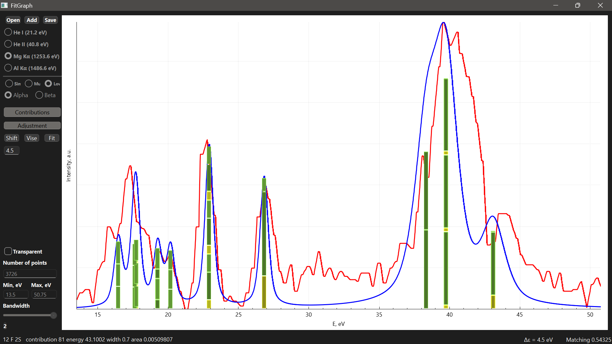

# FitGraph


**FitGraph** — кроссплатформенное настольное приложение на C++/Qt для моделирования ультрафиолетовых (УФЭ, UPS) и рентгеновских (РФЭ, XPS) фотоэлектронных спектров в рамках модели Гелиуса–Зигбана ([DOI: 10.1039/DC9725400257](https://doi.org/10.1039/DC9725400257)) и их прямого сопоставления с экспериментальными данными.

Программа поддерживает моделирование спектров для стандартных лабораторных источников излучения: **He I** (21.2 эВ), **He II** (40.8 эВ), **Mg Kα** (1253.6 эВ) и **Al Kα** (1486.7 эВ). В следующих версиях планируется добавить произвольный выбор энергии фотонов для задач синхротронной спектроскопии.



---

## Область применения

**Научные направления:** физика конденсированного состояния, материаловедение и нанотехнологии, квантовая химия, фотоэлектронная и синхротронная спектроскопия.

**Основные задачи, которые решает FitGraph:**
* Быстрое сопоставление расчётного и экспериментального УФЭ/РФЭ-спектров систем с любым числом атомов.
* Подбор и валидация квантово-химического метода моделирования (обменно-корреляционного функционала DFT, базисного набора) для исследуемого класса соединений.
* Визуализация парциальных вкладов отдельных атомных подуровней в каждую спектральную полосу.
* Подтверждение пространственной/электронной конфигурации соединения через сравнение теории и эксперимента (в том числе при отсутствии данных РСА).
* Независимая верификация теоретических и экспериментальных спектральных данных, представленных в научных публикациях.
* Подготовка размеченных спектральных данных для задач материаловедения и машинного обучения.

<details>
<summary>Почему недостаточно сравнивать спектр только с энергиями молекулярных орбиталей?</summary>

Сопоставление экспериментальных полос напрямую с расчётными энергиями молекулярных орбиталей (МО) в приближении замороженных орбиталей ограничено тремя факторами:
1. Отсутствует информация об относительных интенсивностях полос.
2. Невозможно количественно оценить вклад конкретных атомов и их подуровней в формирование полосы.
3. Для молекулярных комплексов, содержащих более 20 атомов, высокая плотность энергетических уровней приводит к сильному перекрыванию полос, из-за чего ручная интерпретация и построение модельного спектра становятся крайне трудоёмкими.

FitGraph автоматизирует расчёт интенсивностей и построение огибающей, позволяя быстро анализировать ряды сложных соединений.

</details>

---

## Принцип работы и архитектура

В модели Гелиуса–Зигбана (приближении независимых атомных центров) интегральная интенсивность (площадь) спектральной полосы рассчитывается как линейная комбинация электронных заселённостей атомных подуровней, составляющих МО, и соответствующих атомных сечений фотоионизации.

Каждая расчётная полоса аппроксимируется функцией псевдо-Фойгта. Над энергетической шкалой дополнительно отображаются парциальные вклады атомных подуровней в виде цветных столбцов в цветовой схеме CPK.

**Основные модули проекта:**
* [`src/foutput.cpp`](src/foutput.cpp) — парсинг энергий МО и электронных заселённостей из выходных файлов квантово-химических пакетов.
* [`src/fdatapcs.cpp`](src/fdatapcs.cpp) — загрузка атомных сечений фотоионизации, параметров асимметрии и справочных данных (атомные номера, цвета CPK) из data/atomic_data.json.
* [`src/felement.cpp`](src/felement.cpp) — хранение параметров химических элементов, входящих в состав молекулы.
* [`src/fcalculation.cpp`](src/fcalculation.cpp) — расчёт сечений фотоионизации МО по модели Гелиуса–Зигбана и построение теоретического спектра.
* [`src/fexperimental.cpp`](src/fexperimental.cpp) — импорт оцифрованного экспериментального спектра.
* [`src/fadjusting.cpp`](src/fadjusting.cpp) — инструменты сопоставления: энергетический сдвиг спектров относительно друг друга, нормировка по интегральной площади и автоматическая подгонка полуширин полос под экспериментальные пики и перегибы.
* [`src/fitgraphmainwindow.cpp`](src/fitgraphmainwindow.cpp) — графический интерфейс пользователя и визуализация на базе [QCustomPlot](https://www.qcustomplot.com/).

---

## Входные данные

Для работы с FitGraph требуются:
1. **Выходной файл квантово-химического расчёта** (`.out` или `.log`), полученный в одном из поддерживаемых пакетов:
   * [ORCA](https://orcaforum.kofo.mpg.de/)
   * [CP2K](https://www.cp2k.org/)
   * [GAMESS US](https://www.msg.chem.iastate.edu/gamess/)
   * [FireFly](http://classic.chem.msu.su/gran/gamess/)
   * [Gaussian](https://gaussian.com/)
2. **Экспериментальный спектр (опционально):** оцифрованный текстовый файл (`.dat`), полученный на источнике He I, He II, Mg Kα или Al Kα.
   * *Формат файла:* два столбца (энергия связи в эВ, интенсивность), разделённые пробелом или табуляцией, десятичный разделитель — точка.

Примеры входных файлов для быстрой проверки программы доступны в директории [`examples/`](examples/).

---

## Сборка и запуск

### Требования
* **Qt:** Qt 6.x (модули `Core`, `Gui`, `Widgets`, `PrintSupport`).
* **Компилятор:** C++20 совместимый (MinGW / MSVC на Windows, GCC / Clang на Linux).

### Вариант 1: через Qt Creator
1. Установите **Qt** и **Qt Creator** через [Qt Online Installer](https://www.qt.io/download), выбрав нужную версию Qt 6 и компилятор для вашей ОС.
2. Клонируйте репозиторий:
   ```bash
   git clone [https://github.com/skythor73/FitGraph.git](https://github.com/skythor73/FitGraph.git)
   ```
3. В Qt Creator выберите **Файл → Открыть файл или проект...** и откройте [`FitGraph.pro`](FitGraph.pro).
4. Выберите доступный комплект сборки (**Kit**) и нажмите **Настроить проект**.
5. Нажмите **Сборка → Собрать проект** (`Ctrl+B`), затем **Запустить** (`Ctrl+R`).

### Вариант 2: из командной строки (qmake)
```bash
git clone [https://github.com/skythor73/FitGraph.git](https://github.com/skythor73/FitGraph.git)
cd FitGraph
mkdir build && cd build
qmake ../FitGraph.pro
make -j$(nproc)   # или mingw32-make / nmake на Windows
```

---

## Цитирование

Если вы используете **FitGraph** в своих исследованиях, пожалуйста, сошлитесь на мою публикацию *(статья готовится к публикации, библиографические данные и DOI будут обновлены после выхода)*:

```bibtex
@article{Chekh2026FitGraph,
  author  = {Chekh, Alexander},
  title   = {FitGraph: [Название научной статьи]},
  journal = {[Название журнала]},
  year    = {2026},
  note    = {Manuscript in preparation / submitted},
  url     = {[https://github.com/skythor73/FitGraph](https://github.com/skythor73/FitGraph)}
}
```

---

## Лицензия и сторонние компоненты

* Исходный код **FitGraph** распространяется под лицензией **GNU General Public License v3.0 (GPLv3)**. Полный текст лицензии приведён в файле [LICENSE](LICENSE) и доступен по адресу [https://www.gnu.org/licenses/gpl-3.0.html](https://www.gnu.org/licenses/gpl-3.0.html).
* Для построения графиков используется библиотека [QCustomPlot](https://www.qcustomplot.com/) (`3rdparty/qcustomplot/`), также распространяемая по лицензии GNU GPLv3.
* Для матричной алгебры используется библиотека [Eigen](https://libeigen.gitlab.io/) (`3rdparty/Eigen/`), распространяемая по лицензии MPL-2.0.

### Авторское право

&copy; 2022–2026 Александр Чех.

Исключительные права на программу для ЭВМ зарегистрированы в установленном порядке (номер свидетельства о государственной регистрации предоставляется по запросу). Все права, не предоставленные явно условиями лицензии GNU GPLv3, сохраняются за правообладателем.